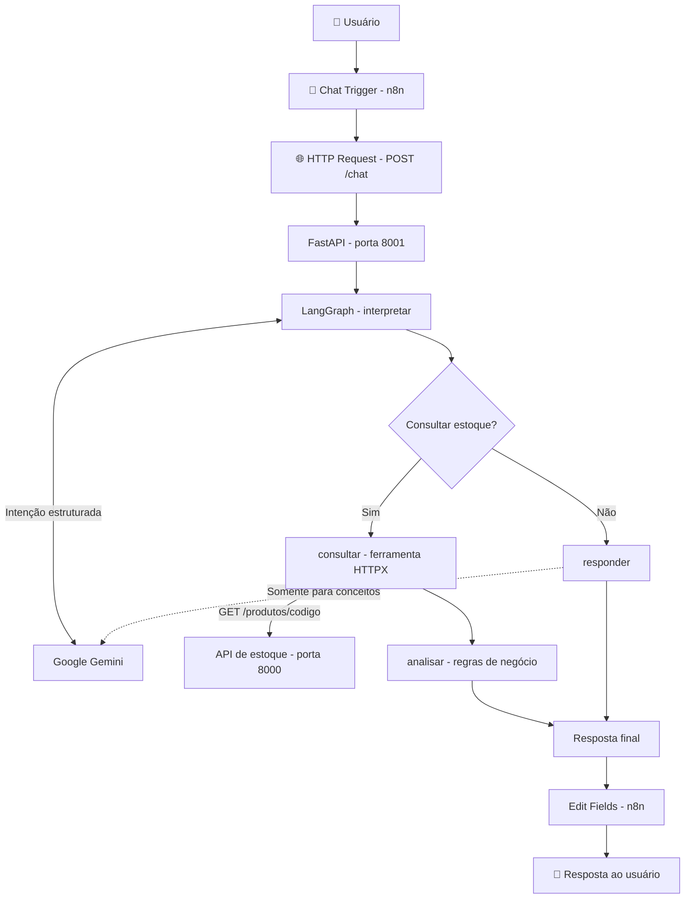
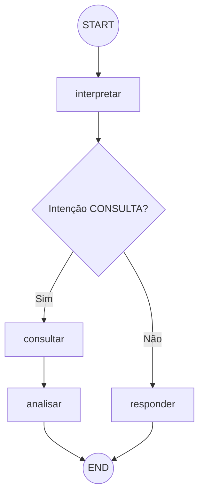
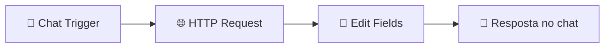

<div align="center">

# 🛡️ StockGuard IA

### Agente inteligente de gestão e monitoramento de estoques

**Projeto final • SENAI • Agentes de Inteligência Artificial • Turma 2 • 2026**


[Sobre](#-sobre-o-projeto) • [Arquitetura](#-arquitetura) • [Instalação](#-instalação-e-configuração) • [Testes](#-testes-e-evidências) • [Vídeo](#-vídeo-de-demonstração)

</div>

---

## 📌 Sobre o projeto

O **StockGuard IA** é um agente conversacional que auxilia na gestão de estoques por meio de perguntas em linguagem natural. Ele combina um modelo de linguagem (LLM), um grafo de execução com decisões condicionais, uma ferramenta HTTP em Python e um workflow n8n.

O modelo interpreta a intenção do usuário; o código Python consulta e valida os dados da API de estoque e aplica regras de negócio determinísticas. Dessa forma, as quantidades informadas nas consultas são provenientes da API, e não estimativas geradas pelo modelo.

## 🎯 Problema e objetivos

A consulta manual de estoques pode dificultar a identificação de produtos com necessidade de reposição. O StockGuard IA propõe uma interface simples para transformar perguntas em consultas estruturadas e recomendações objetivas.

- Facilitar o acesso às informações de estoque.
- Identificar produtos com estoque normal, baixo ou esgotado.
- Calcular a quantidade mínima necessária para reposição.
- Evitar consultas desnecessárias à API de estoque.
- Tratar entradas inválidas, ambiguidades e falhas de comunicação.
- Impedir alterações de estoque não autorizadas.
- Demonstrar integração real entre Python, LangGraph, LLM e n8n.

## ✨ Funcionalidades

| Recurso | Descrição |
|---|---|
| 💬 Linguagem natural | Interpreta perguntas em português |
| 🧠 IA generativa | Classifica a intenção e responde a questões conceituais |
| 🔎 Consulta de produto | Busca um código PRD-XXX na API REST |
| 📦 Diagnóstico | Classifica a situação do estoque |
| 🧮 Reposição | Calcula a quantidade necessária para atingir o mínimo |
| 🔀 Roteamento | Decide quando consultar a API de estoque |
| ❓ Esclarecimento | Solicita um código quando a pergunta é ambígua |
| 🚧 Escopo | Redireciona perguntas não relacionadas a estoque |
| ⚠️ Resiliência | Trata produtos inexistentes, falhas HTTP e dados inválidos |
| 🔒 Segurança | Bloqueia solicitações de escrita |
| 🌐 Interface | Disponibiliza chat integrado ao n8n |

## 🏗️ Arquitetura



### 🔀 Grafo de execução



| Nó | Responsabilidade |
|---|---|
| `interpretar` | Classifica a intenção com o Gemini e valida o código extraído |
| `consultar` | Executa a ferramenta HTTP de consulta |
| `analisar` | Aplica regras de estoque e produz resposta fundamentada |
| `responder` | Trata conceitos, ambiguidades, pedidos de alteração e assuntos fora do escopo |

### 🧩 Estado compartilhado

| Campo | Tipo | Finalidade |
|---|---|---|
| `pergunta` | `str` | Entrada do usuário |
| `intencao` | `str` | Classificação da solicitação |
| `codigo` | `str` | Código identificado |
| `dados` | `dict` | Resultado da ferramenta HTTP |
| `resposta` | `str` | Resposta final |

### 🧠 Classificação de intenções

| Intenção | Comportamento | Consulta API de estoque? |
|---|---|---|
| `CONSULTA` | Consulta e analisa um produto | Sim |
| `CONCEITO` | Explica conceitos de estoque com o LLM | Não |
| `ESCLARECIMENTO` | Solicita um único código válido | Não |
| `FORA_ESCOPO` | Informa a especialidade do agente | Não |
| `ALTERACAO` | Recusa a operação de escrita | Não |
| `ERRO` | Informa falha na interpretação | Não |

> Não consultar a API de estoque não significa ausência de chamadas ao Gemini. O modelo é utilizado na interpretação e, quando necessário, na resposta conceitual.

## 📊 Regras de negócio

| Situação | Condição | Ação recomendada |
|---|---|---|
| 🔴 ESGOTADO | Atual = 0 | Priorizar reposição |
| 🟠 BAIXO | 0 < Atual < Mínimo | Recomendar reposição |
| 🟡 NORMAL (no limite) | Atual = Mínimo e Atual > 0 | Monitorar |
| 🟢 NORMAL | Atual > Mínimo | Manter monitoramento |

A condição de estoque zero tem prioridade. Existem três classificações efetivas no código: NORMAL, BAIXO e ESGOTADO.

```python
reposicao_necessaria = max(0, estoque_minimo - estoque_atual)
```

A quantidade calculada representa o necessário para atingir o mínimo cadastrado, não uma previsão de demanda ou uma ordem de compra.

## 🛠️ Tecnologias utilizadas

| Tecnologia | Aplicação |
|---|---|
| 🐍 Python 3.12 | Desenvolvimento do agente |
| 🤖 Gemini (`gemini-3.5-flash-lite`) | Interpretação e respostas conceituais |
| 🔗 LangChain | Integração com o LLM |
| 🕸️ LangGraph | Estado, nós e roteamento condicional |
| 🧾 Pydantic | Validação estruturada |
| 🌐 HTTPX | Cliente HTTP |
| ⚡ FastAPI | Interface HTTP do agente |
| 🚀 Uvicorn | Servidor ASGI |
| 🔄 n8n | Automação e chat |
| 🔑 python-dotenv | Variáveis de ambiente |
| 🗃️ Git / GitHub | Versionamento e entrega |
| 💻 VS Code | Ambiente de desenvolvimento |

## 📁 Estrutura do repositório

```text
StockGuard-IA/                 # conteúdo da pasta local agente
├── agente.py                  # grafo principal
├── analise.py                 # regras de estoque
├── tools.py                   # ferramenta HTTP e validações
├── servidor.py                # interface FastAPI
├── teste_langgraph.py         # exercício de grafo
├── teste_condicional.py       # exercício de roteamento
├── teste_gemini.py            # teste de integração com LLM
├── teste_intencao.py          # teste de classificação
├── stockguard_workflow.json   # workflow exportado do n8n
├── requirements.txt          # dependências Python
├── .env.example              # exemplo sem credenciais
├── .gitignore                 # exclusões do versionamento
├── TESTES.md                  # relatório de testes
├── README.md                  # documentação principal
└── evidencias/                # capturas dos testes
```

A API de estoque do professor permanece em um diretório separado. Os arquivos `.env`, `.venv/` e `__pycache__/` não devem ser publicados.

## 🚀 Instalação e configuração

### 1️⃣ Pré-requisitos

- Python 3.12 e Git.
- Node.js compatível com a versão instalada do n8n e npm.
- Chave de API do Google Gemini com acesso ao modelo configurado.
- Acesso à internet para o Gemini e instalação das dependências.

### 2️⃣ Preparar o agente

Baixe ou clone este repositório pelo botão **Code** do GitHub. Abra um PowerShell na pasta que contém `agente.py`:

```powershell
python -m venv .venv
.\.venv\Scripts\Activate.ps1
python -m pip install -r requirements.txt
Copy-Item .env.example .env
```

Edite `.env` com sua própria chave:

```dotenv
GOOGLE_API_KEY=COLOQUE_SUA_CHAVE_AQUI
CHAT_MODEL=gemini-3.5-flash-lite
```

Obtenha a chave no [Google AI Studio](https://aistudio.google.com/apikey). A disponibilidade do modelo depende da conta e do provedor.

### 3️⃣ Iniciar a API de estoque (terminal 1)

Em uma pasta separada, clone a API disponibilizada pelo professor:

```powershell
git clone https://github.com/wangsouza/api-estoque.git
cd api-estoque
python -m venv .venv
.\.venv\Scripts\Activate.ps1
python -m pip install -r requirements.txt
python -m uvicorn app.main:app --host 127.0.0.1 --port 8000
```

- Swagger: http://127.0.0.1:8000/docs
- Verificação: http://127.0.0.1:8000/health
- Catálogo: http://127.0.0.1:8000/produtos

### 4️⃣ Executar o agente pelo terminal (opcional)

Em outro terminal, na pasta do agente, com seu ambiente virtual ativo:

```powershell
python agente.py
```

Digite `sair` para encerrar o modo interativo.

### 5️⃣ Iniciar o servidor do agente (terminal 2)

```powershell
.\.venv\Scripts\Activate.ps1
python -m uvicorn servidor:app --host 127.0.0.1 --port 8001
```

Swagger: http://127.0.0.1:8001/docs

### 6️⃣ Iniciar o n8n (terminal 3)

Caso ainda não esteja instalado:

```powershell
npm.cmd install -g n8n
```

Inicie o serviço:

```powershell
n8n.cmd start
```

Acesse http://localhost:5678, configure a conta local se necessário e importe `stockguard_workflow.json` pelo menu de importação do editor. Abra o chat de teste do workflow.

> Mantenha os três serviços ativos durante os testes integrados. A configuração utiliza localhost; não foi projetada para exposição pública.

## 🔌 Integração HTTP

### API do professor — porta 8000

| Método | Endpoint | Finalidade |
|---|---|---|
| GET | `/health` | Verificar disponibilidade |
| GET | `/produtos` | Listar catálogo |
| GET | `/produtos/{codigo}` | Consultar um produto |

A ferramenta do agente utiliza o endpoint de consulta individual. O catálogo é útil para inspeção manual.

### API do StockGuard IA — porta 8001

**POST `/chat`**

```json
{
  "pergunta": "Preciso repor o estoque do PRD-001?"
}
```

Teste pelo PowerShell:

```powershell
$body = @{ pergunta = 'Preciso repor o estoque do PRD-001?' } | ConvertTo-Json
Invoke-RestMethod -Method Post -Uri 'http://127.0.0.1:8001/chat' -ContentType 'application/json' -Body $body
```

A resposta inclui a pergunta, intenção, código e resposta textual do agente.

## 🔄 Workflow n8n



| Nó | Configuração |
|---|---|
| Chat Trigger | Recebe `chatInput`; resposta ao finalizar o último nó |
| HTTP Request | POST para `http://127.0.0.1:8001/chat` |
| Edit Fields | Campo `output` com o valor de `resposta` |

Corpo JSON enviado ao Python:

```text
Campo: pergunta
Expressão: {{ $json.chatInput }}
```

Mapeamento da saída:

```text
Campo: output
Expressão: {{ $json.resposta }}
```

📥 [Workflow exportado em JSON](stockguard_workflow.json)

## 💬 Exemplos de utilização

### 🟠 Estoque baixo

**Pergunta:** Preciso repor o estoque do PRD-001?

```text
Produto: Mouse sem fio
Código: PRD-001
Categoria: Periféricos
Estoque atual: 5 un
Estoque mínimo: 10 un
Situação: BAIXO
Reposição necessária: 5 un
Recomendação: Recomenda-se reposição.
```

### 🔴 Estoque esgotado

**Pergunta:** Qual o estoque do PRD-004?

```text
Produto: Cabo HDMI 2 m
Estoque atual: 0 un
Estoque mínimo: 20 un
Situação: ESGOTADO
Reposição necessária: 20 un
```

### 🟢 Estoque normal

**Pergunta:** Qual o estoque do PRD-002?

```text
Produto: Teclado USB
Estoque atual: 40 un
Estoque mínimo: 15 un
Situação: NORMAL
Reposição necessária: 0 un
```

### 🔒 Solicitação de alteração

**Pergunta:** Altere o estoque do PRD-001 para 100 unidades.

**Comportamento:** recusa a alteração e informa que nenhum dado foi modificado.

## 🧪 Testes e evidências

Os testes foram realizados manualmente no ambiente de desenvolvimento, tanto no terminal quanto na interface do n8n. A tabela apresenta os resultados funcionais registrados durante o desenvolvimento.

| Cenário | Entrada | Resultado esperado e observado |
|---|---|---|
| Estoque baixo | PRD-001 | ✅ BAIXO; reposição 5 un |
| Estoque normal | PRD-002 | ✅ NORMAL; reposição 0 |
| Estoque esgotado | PRD-004 | ✅ ESGOTADO; reposição 20 un |
| Estoque no limite | PRD-005 | ✅ NORMAL; monitoramento |
| Produto inexistente | PRD-999 | ✅ Produto não encontrado |
| Falha simulada | PRD-503 | ✅ Serviço indisponível |
| Conceito | O que é estoque mínimo? | ✅ Resposta conceitual sem API de estoque |
| Ambiguidade | Como está meu estoque? | ✅ Solicita código |
| Fora do escopo | Qual a capital da França? | ✅ Redireciona ao escopo |
| Escrita | Alterar PRD-001 para 100 | ✅ Operação recusada |
| Múltiplos códigos | PRD-001 e PRD-002 | ✅ Solicita um único código |

Também foram registrados testes da ferramenta HTTP, incluindo código inválido, normalização de entradas e rejeição de dados incompletos.

**Integração n8n:** nove cenários concluídos com sucesso, conforme registro manual do desenvolvimento. Foram salvas onze capturas de evidência, incluindo demonstrações do roteamento com e sem consulta à API de estoque.

- 📋 [Relatório detalhado de testes](TESTES.md)
- 📸 [Capturas de tela e evidências](evidencias/)

Os resultados não representam uma certificação de produção nem uma suíte automatizada de regressão.

## ⚠️ Tratamento de erros

| Evento | Tratamento |
|---|---|
| Código fora do padrão PRD-XXX | Validação antes da consulta HTTP |
| HTTP 404 | Produto não encontrado |
| HTTP 503 | Serviço temporariamente indisponível |
| Outros códigos HTTP | Mensagem de erro da API |
| Falha de conexão ou timeout | Mensagem de indisponibilidade de conexão |
| JSON inválido | Rejeição da resposta |
| Campos ausentes ou quantidades inválidas | Rejeição dos dados |
| Falha do LLM | Mensagem de indisponibilidade ou erro de interpretação |

## 🔐 Segurança e uso responsável

- Operação exclusivamente de leitura: não há ferramenta de escrita de estoque no agente.
- Chaves de API armazenadas em `.env`, fora do versionamento.
- Validação do formato do código e conferência do código extraído com a entrada do usuário.
- Validação dos campos retornados pela API, inclusive quantidades inteiras não negativas.
- Regras de negócio executadas em Python, sem delegar cálculos de estoque ao LLM.
- Serviços configurados para execução local.
- Não enviar informações confidenciais ao chat: perguntas são encaminhadas ao provedor do LLM.

Antes de publicar, verificar se o `.gitignore` exclui `.env`, `.venv/`, `__pycache__/` e `*.pyc`, e se o workflow e as capturas não contêm credenciais.

## 📋 Atendimento aos requisitos acadêmicos

| Requisito | Implementação |
|---|---|
| LLM em Python | Gemini via LangChain |
| Estado compartilhado | TypedDict no LangGraph |
| Mínimo de dois nós | Quatro nós funcionais |
| Roteamento condicional | Consulta ou resposta sem API de estoque |
| Encerramento | Ambos os caminhos terminam em END |
| Ferramenta HTTP | HTTPX em `tools.py` |
| Validação de entrada e saída | Código, campos e quantidades |
| Classificação de estoque | Regras em `analise.py` |
| Integração n8n | Chat, POST HTTP e mapeamento de resposta |
| Workflow exportado | `stockguard_workflow.json` |
| Proteção contra escrita | Operação somente leitura |
| Testes e evidências | `TESTES.md` e `evidencias/` |
| Documentação | Este README |
| Vídeo de até cinco minutos | Link pendente de gravação |

## 🚧 Limitações conhecidas

- Consulta individual por código; não pesquisa por nome ou categoria.
- Não mantém memória persistente de conversação.
- Depende da disponibilidade da API de estoque e do Gemini.
- Classificação de intenção por LLM pode variar ou falhar.
- Respostas conceituais não utilizam uma base documental verificada.
- Não calcula previsão de demanda, prazo de entrega ou estoque ótimo.
- Não possui autenticação de produção, controle de acesso ou interface pública segura.
- Testes manuais; instalação em outro computador ainda não validada.

## 🗺️ Melhorias futuras

- [ ] Pesquisa por nome e categoria.
- [ ] Consulta de múltiplos produtos.
- [ ] Dashboard de indicadores.
- [ ] Alertas de estoque baixo via n8n e Telegram.
- [ ] Histórico de consultas e auditoria.
- [ ] Testes automatizados e integração contínua.
- [ ] Autenticação e implantação segura.

## 🎬 Vídeo de demonstração

**Link:** pendente de gravação e publicação.

O vídeo deverá apresentar o objetivo, o grafo, a ferramenta HTTP, a integração n8n e os cenários de teste, respeitando o limite de cinco minutos.

## 🎓 Créditos

**Instituição:** SENAI  
**Curso:** Agentes de Inteligência Artificial — Turma 2 — 2026  
**Professor:** Wang Souza  
**Projeto:** StockGuard IA

API de estoque disponibilizada pelo professor: [wangsouza/api-estoque](https://github.com/wangsouza/api-estoque).

### 📚 Referências técnicas

- [Python](https://docs.python.org/3/)
- [LangGraph e LangChain](https://docs.langchain.com/)
- [Google Gemini API](https://ai.google.dev/)
- [FastAPI](https://fastapi.tiangolo.com/)
- [HTTPX](https://www.python-httpx.org/)
- [n8n](https://docs.n8n.io/)

---

<div align="center">

### 🛡️ StockGuard IA

**Dados confiáveis • Decisões inteligentes • Gestão eficiente**

Desenvolvido como projeto acadêmico de integração de agentes de IA e automação de processos.

</div>
